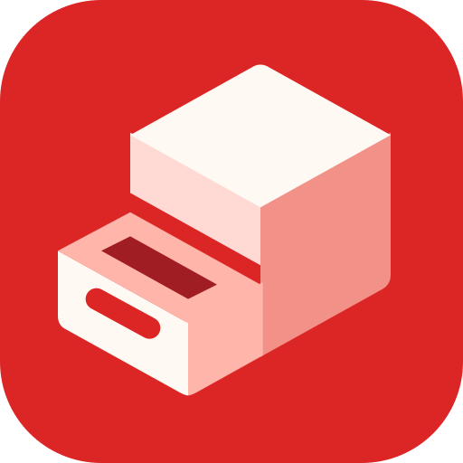
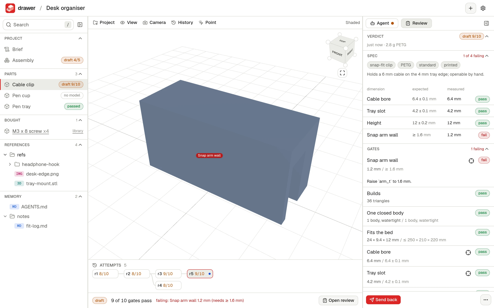
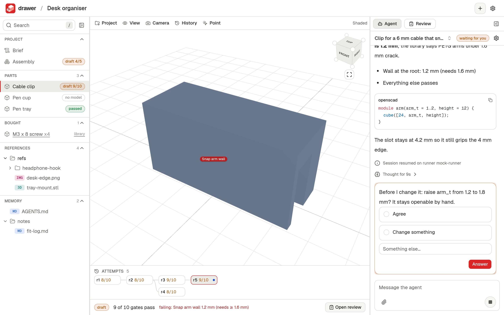
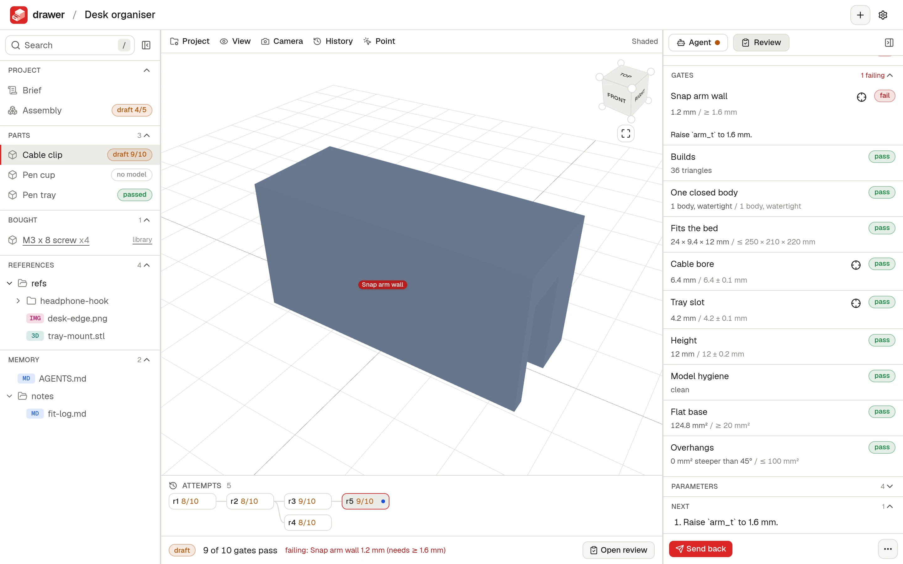
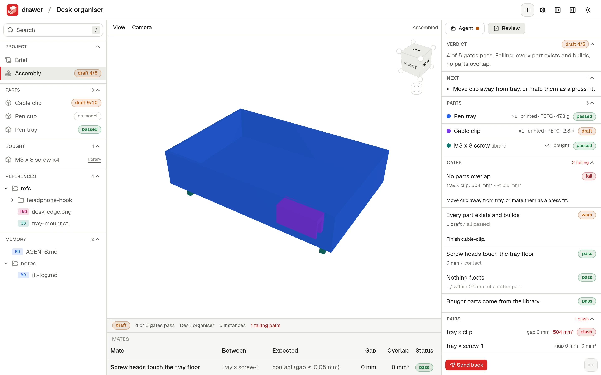
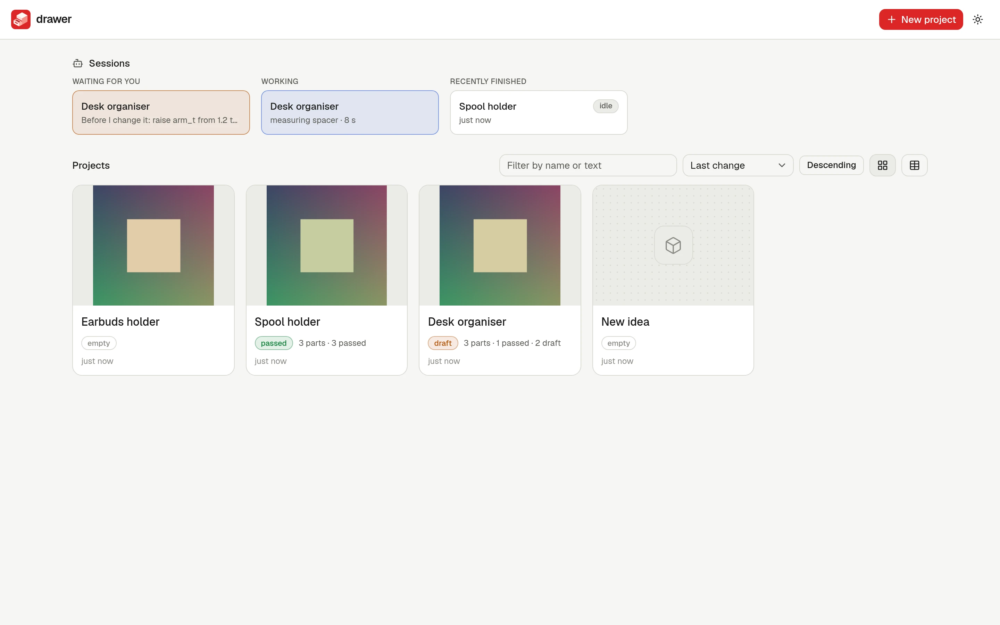

<p align="center">
  
</p>

<h1 align="center">drawer</h1>

<p align="center">
  <strong>An agent models your parts. The server checks them.</strong><br>
  A self-hosted CAD workspace for 3D printing: you say what you need, an agent writes it in OpenSCAD, and the server
  measures every model against its spec and decides when a part is done.
</p>

<p align="center">
  <a href="#get-started">Get started</a> ·
  <a href="https://spyrosbazios.github.io/drawer/">Website</a> ·
  <a href="#documentation">Documentation</a> ·
  <a href="CONTRIBUTING.md">Contribute</a>
</p>

<p align="center">
  <a href="LICENSE"></a>
  <a href="https://github.com/spyrosbazios/drawer/pkgs/container/drawer"></a>
  <a href="skill/drawer/SKILL.md"></a>
</p>

<picture>
  <source media="(prefers-color-scheme: dark)" srcset="docs/assets/part-dark.webp">
  
</picture>

*The web app with sample data: a part, its attempts, and the gates that decide its status.*

## A person decides what. The agent decides how. The mesh decides whether.

### You state intent

Write a brief, attach a photo or a datasheet, answer the agent's one question. After that you change intent only: a
spec, a parameter value, a waiver, a print result. There is no model editor and no sketcher.

### The agent models

It reads the project, writes a spec with a tolerance on every size that matters, then writes a parametric OpenSCAD
model. After every write it reads the report and fixes the first failing gate.

### The server measures and decides

Every model is rendered and measured on the mesh: bores, gaps, walls, bed contact, overhangs, whether it fits the
bed. A part's status comes only from those gates. No client can set it, and nothing trusts what a model says about
itself, so an agent cannot call a part done. It can only make the gates pass.

### Files are the truth

A project is a plain folder: the brief, parts, specs, the assembly, references and notes. The server keeps each one
as a git repository, so every attempt is a revision you can compare or restore. Notes are the project's memory:
facts and links in them are indexed, and the next session reads them first.

## In the app

| | |
|---|---|
|  |  |
| *Talk to the agent. It says what it found and asks before it changes direction.* | *Review a part: waive a gate, change a parameter, record a print result, or send it back.* |
|  |  |
| *Assemblies place parts and bought components together and check mates, clearances and clashes.* | *Home: the sessions waiting for you, the shared library, every project's status.* |

Screens use sample data from the web app's mock server. The same app installs on a phone.

## Any agent

- **The built-in agent** runs on your machine, in a runner that gives the model drawer's tools and nothing else: no
  shell, no file system, no web. It drives Claude Code, Codex, Pi or Gemini with the login each already has on that
  host; you pick the provider and model per session. [Runner](agent/README.md)
- **Your own agent** (Claude Code, Codex, anything with a shell) drives the same HTTP API through the `drawer` CLI and
  a skill that teaches it the method. The built-in agent has no private path. [CLI and skill](skill/README.md)
- **Imports** bring a model in from Printables, Thingiverse, MakerWorld, Cults3D or MyMiniFactory, with its files,
  images, author and licence, as a reference the agent can measure.

## Get started

> [!IMPORTANT]
> **drawer is for a private network. There is no sign-in.** Anyone who can reach the server can read, change and
> delete its projects. Keep its port on loopback or a private address, and never expose it to the public internet.
> Read the [security model](SECURITY.md) before deploying.

**Let an agent install it.** Paste this into Claude Code, Codex or any coding agent with a shell, on the computer
that will run drawer: macOS, Linux or Windows. On Windows it sets up WSL2 with you first.

```text
Install drawer on this computer, end to end. Fetch and follow
https://raw.githubusercontent.com/spyrosbazios/drawer/main/INSTALL.md exactly: find out which OS you are on and take
its branch, ask me its step-0 questions first,
run every step and check it, never use sudo or sign in for me (print those commands and wait), and keep the port
private. Finish with the report its last step describes.
```

**Or do it by hand:**

You need Docker with Compose. `docker compose up -d` pulls the published image for amd64 or arm64: the server, the
web app, and OpenSCAD with BOSL2 and MCAD inside.

```sh
git clone https://github.com/spyrosbazios/drawer.git
cd drawer
cp .env.example .env
docker compose up -d
```

On the server machine, open [localhost:3050](http://localhost:3050). Projects are stored in `./data`. The server runs
as user 1000; if `id -u` prints something else, set `DRAWER_UID` and `DRAWER_GID` in `.env` before starting it.

- **From other devices**: set `DRAWER_BIND` in `.env` to a private address (a VPN or tailnet address), or put a
  private reverse proxy in front. If you reach it by a name rather than an IP address, list the name in
  `DRAWER_ALLOWED_HOSTS`. To install the web app from another device, use [private HTTPS](INSTALL.md#install-the-web-app).
- **The built-in agent** is not in the image, because it uses your provider logins: install the
  [runner](agent/README.md) on a machine that has Claude Code, Codex, Pi or Gemini signed in.
- **Your own agent**: install the [CLI and the skill](skill/README.md), then `drawer server http://<host>:3050`.
- **Import tokens** are optional and go in `.env`. Printables needs none.
- **From source**: `docker compose -f docker-compose.yml -f docker-compose.build.yml up -d --build`.

## Backups

Back up `data/`: it holds every project, session and note, and it is the only copy. `data/index.db` and `data/cache/`
are derived and can be left out. drawer makes no backups of its own.

## Documentation

| Start here | What it covers |
|---|---|
| [Install with an agent](INSTALL.md) | Steps a coding agent follows to install drawer hands-off |
| [Spec](docs/SPEC.md) | The model (parts, specs, gates, assemblies, sessions), every route, the CLI |
| [Security](SECURITY.md) | The no-sign-in model, what the server refuses, what a model can read, vulnerability reports |
| [Modelling guide](server/src/guide.md) | The method every agent follows |
| [CLI and skill](skill/README.md) | Installing the `drawer` command and the skill for an outside agent |
| [Agent runner](agent/README.md) | Running the built-in agent as a service |
| [AGENTS.md](AGENTS.md) | Invariants, footguns, development and deployment |

## Contributing

Issues and pull requests are welcome: see [CONTRIBUTING.md](CONTRIBUTING.md). Changes are listed in the
[changelog](CHANGELOG.md).

## License

[GNU AGPL-3.0](LICENSE). Contributions require a one-time [Contributor License Agreement](CLA.md). OpenSCAD, BOSL2 and
MCAD are downloaded into the image under their own licences, and the UI components in `web/src/components/ui/` are
[shadcn/ui](https://ui.shadcn.com) output (MIT).
